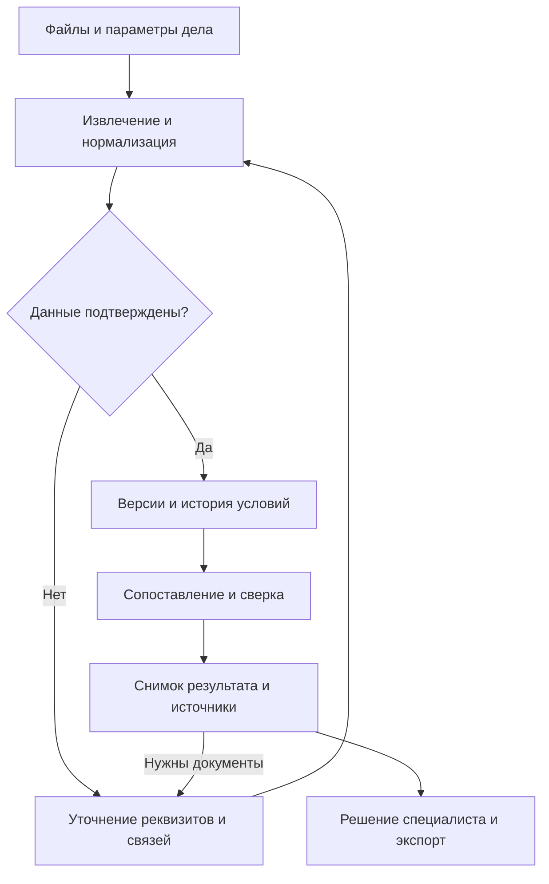

# Техническая архитектура системы «Контроль исполнения»

## Назначение и границы реализации

Система реализована как локальный демонстрационный модуль сверки документов исполнения одного контракта. Она принимает контракт с позициями либо связанной спецификацией, документы поставки, акты приёмки и дополнительные соглашения. Результат содержит сопоставленные строки, рассчитанные объёмы, информационные сигналы и основания каждого вывода. Специалист может исправить извлечение, подтвердить связь позиций и сохранить решение по сигналу.

Основание требований – разделы 7–10 исходного исследования «финал финал(1).pdf», страницы 8–12, и перечень из 13 задач разработки. Исследование задаёт сценарии, но не предоставляет реальный ведомственный набор документов. Поэтому в проект включены явно обозначенные синтетические примеры и отдельный эталон ожидаемого поведения. Система не записывает данные в ЕИС, ЕАИСТ или Портал поставщиков, не выполняет приёмку и платежи. Документальное несовпадение остаётся вопросом для проверки.

## Состав приложения

Приложение написано на Python 3.11 или новее. FastAPI предоставляет HTTP API, Pydantic проверяет структуры входных и выходных данных, Uvicorn запускает сервер. SQLite хранит дела, документы, версии извлечения, результаты запусков и решения проверяющих. Исходные файлы сохраняются рядом с базой. Для текстовых PDF применяется pdfplumber, для DOCX – python-docx, для изображений – Pillow. Необязательный OCR выполняют локальный Tesseract и Poppler.

Ядро не вызывает внешние модели и не требует ключа API. В нём нет LLM, эмбеддингов или случайного выбора кандидата. Это позволяет повторить расчёт на сохранённом наборе данных и отдельно исследовать ошибки извлечения и ошибки правил.

| Модуль | Ответственность |
| --- | --- |
| `models.py` | Общая схема документов, строк, источников, ручных связей и результатов |
| `normalize.py` | Нормализация чисел, дат, названий, идентификаторов, единиц и валют |
| `extract.py` | Чтение файлов, извлечение реквизитов и таблиц, предупреждения OCR |
| `engine.py` | Разрешение версий, история условий, сопоставление и правила сверки |
| `storage.py` | SQLite, исходные файлы, снимки проверок, история исправлений и рассмотрения |
| `api.py` | Загрузка, управление делами, запуск сверки и интеграция с интерфейсом |
| `exports.py` | Самостоятельные HTML-отчёты, CSV сигналов и защита экспортируемого текста |
| `__main__.py` | Извлечение, сверка и демонстрационные сценарии из командной строки |

Интерфейс подключается к тому же API, что и автоматические проверки. Проверку можно выполнить без сервера через `python -m kontrol check` или вызвать как Python-функцию `run_check(CheckRequest)`.

## Модель данных

Основная единица хранения – проверочное дело. В нём собраны документы одного контракта и несколько независимых запусков сверки. Документ имеет собственный ID, тип, номер, дату и ссылку на контракт. Его строки содержат исходные значения и ссылки на места извлечения. Структура допускает неизвестные значения: отсутствие числа представлено `None`, а не нулём.

| Сущность или поле | Назначение и правило |
| --- | --- |
| `Document.id`, `number`, `contract_id` | Техническая идентичность документа, его номер и принадлежность контракту |
| `type`, `status` | Тип документа; активный, отменённый, заменённый либо черновик |
| `date`, `effective_from`, `deadline` | Дата документа, начало действия условий и срок поставки |
| `revision`, `logical_id`, `supersedes` | Заявленная редакция, группа одного документа и явная ссылка на исправляемую версию |
| `specification_id` | Начальная спецификация, выбранная контрактом |
| `base_document_id`, `replacement_spec_id`, `approved` | Основание изменения, новая полная спецификация и подтверждение её применения специалистом |
| `related_delivery_ids`, `acceptance_mode` | Связанные накладные; отдельные объёмы приёмки либо накопительный итог |
| `Item.line_id`, `position_id`, `sku` | Строка документа, явная позиция контракта и артикул; эти поля не подменяют друг друга |
| `quantity`, `unit_price`, `amount` | Количество, цена единицы и итоговая сумма строки с НДС |
| `currency`, `tax_included`, `vat_rate`, `discount_percent` | Параметры приведения цены к сопоставимому виду |
| `conversion_factor`, `conversion_to` | Подтверждённый перевод исходной единицы в единицу спецификации |
| `SourceRef` | Документ, файл, страница, строка, поле и исходный фрагмент |
| `ManualLink` | Исходная строка, целевая строка спецификации, проверяющий и обязательный комментарий |
| `CheckRequest.as_of` | Явно заданная дата среза; текущая дата компьютера не используется |

У документа существуют два разных понятия версии. Поле `Document.revision` относится к деловой редакции документа. Счётчик версии записи в SQLite увеличивается при исправлении распознанных данных пользователем. Второй счётчик защищает от одновременной перезаписи, но сам по себе не делает новую накладную действующей редакцией старой.

## Конвейер обработки

HTTP-загрузка проверяет расширение и размер, сохраняет байты под служебным именем и вычисляет SHA-256. Повтор тех же байтов внутри дела возвращает уже существующую запись и событие повторной загрузки. Парсер определяет тип, читает реквизиты и таблицы, затем формирует нормализованный `Document`. Неизвестный формат, повреждённый файл или неверная схема возвращают управляемую ошибку. Частично распознанный документ сохраняет предупреждения и пропуски для исправления.

В текстовых форматах поддерживаются реквизиты с подписями и таблицы с известными заголовками. DOCX обрабатывается через настоящие таблицы Word. Для PDF используются доступный текстовый слой и таблицы; изображение страницы при необходимости передаётся локальному OCR. Русский скан требует пакета `rus`. Отсутствие этого пакета не скрывается переключением на английский.

Исходные координаты сохраняются только там, где они известны. У строки PDF указывается страница; у DOCX номер страницы не выдумывается. Оценки извлечения применяются как технический признак необходимости проверки, а не как заявленная статистическая точность. Любой OCR-результат направляется на подтверждение. Буквы в числовой ячейке не исправляются догадкой.

## Выбор документов и условий

Сначала ядро проверяет идентичность документов. Одинаковый ID с разным содержимым создаёт конфликт. Совпавший хеш файла при различающихся извлечённых данных также требует проверки. Полные повторы с теми же реквизитами исключаются из суммирования; две разные накладные с одинаковыми товарами остаются двумя поставками. Для дубликатов сохраняются события и ссылки на выбранную запись.

Отменённые документы и черновики исключаются. Документы, датированные после среза, пока не участвуют. Исправление должно явно указывать `supersedes` на документ того же типа и контракта. Отсутствующее основание, цикл исправлений, несколько конкурирующих исправлений или несовместимые актуальные версии не разрешаются произвольным выбором наибольшего номера.

Исходные условия берутся из строк выбранного контракта либо из его `specification_id`. Дополнительное соглашение применяется только при подтверждении `approved`, известном основании и наступившей дате действия. Изменение может задавать новый срок и/или полную новую спецификацию. Несколько изменений на одну дату без однозначного порядка создают сигнал. Свободный текст соглашения не превращается автоматически в набор исполняемых правок.

Количество исполнения сравнивается с редакцией на дату среза. Цена и срок поставки проверяются по условиям, действовавшим на дату документа поставки. Для акта с явными ссылками учитываются даты связанных поставок. Если они относятся к разным ценовым условиям и строка акта не позволяет выбрать основание, цена не усредняется: система просит уточнить связи или разделить строки.

## Сопоставление строк

Первый приоритет имеет сохранённая ручная связь. Затем проверяются явный номер позиции, уникальный артикул и точное уникальное нормализованное название. Противоречие артикула и позиции блокирует автоматическое решение. Неизвестный артикул нельзя компенсировать похожим названием. Если один артикул встречается в нескольких строках, требуется выбор специалиста.

Для похожих названий применяется `SequenceMatcher`. Он формирует до трёх предложений, но не подтверждает связь самостоятельно. Коэффициент сходства не интерпретируется как вероятность правильного совпадения. Низкая уверенность идентификатора или названия также переводит связь на ручную проверку.

`ManualLink` хранит ID документа, его строку и целевую строку текущей спецификации. Поля `reviewer` и `comment` обязательны. Ядро проверяет существование исходной строки и назначения, а противоречащие ручные связи не объединяет. При неразрешённой связи затронутые итоги считаются неполными; неизвестная строка не исчезает бесследно из расчёта.

## Количество, цена и остальные проверки

Накладные и акты суммируются отдельно. Поставка 8 и 2 единиц образует 10 поставленных; акт на 10 означает 10 принятых, а не ещё 10 поставленных. Явные связи между актами и накладными дополнительно проверяются группами, чтобы общий итог не скрывал ошибочную привязку отдельного акта. Несколько отдельных актов могут ссылаться на одну накладную.

Если комплект не объявлен завершённым, остаток по контракту отображается без автоматического сигнала о недопоставке. При `delivery_complete=true` неполный документальный объём создаёт проверочный сигнал. Превышение приёмки над накладными формулируется как расхождение текущего комплекта с предложением проверить дополнительные документы. Накопительные акты `cumulative` не складываются с отдельными: для них возвращается ограничение и запрос разбиения.

Единицы нормализуются по словарю. Для метрических величин поддержаны переводы в пределах массы, длины и объёма. Упаковка не приравнивается штуке: нужны `conversion_factor` и `conversion_to`. По тому же коэффициенту приводится цена единицы.

Денежная арифметика использует `Decimal` с фиксированным контекстом. Сопоставимая цена равна цене единицы после скидки и, если налог не включён, после добавления явно указанного НДС. Цены разных валют не сравниваются без предусмотренного правила пересчёта; валютный пересчёт в этой версии не реализован. Допуск по умолчанию составляет 0,01. Сумма строки проверяется как количество, умноженное на приведённую цену исходной единицы, с округлением до двух знаков `ROUND_HALF_UP`.

Ядро также проверяет принадлежность контракту, срок документа поставки, наличие требуемых типов документов и явно заданные характеристики товара. Отсутствующее количество, неизвестный налоговый базис или низкая уверенность блокируют соответствующий вывод. Подробность сигнала сохраняется: код, ожидаемое и фактическое значения, формула либо правило, источники и признак блокировки.

## Хранение, рассмотрение и интеграция

SQLite содержит таблицы `cases`, `documents`, `document_versions`, `runs`, `reviews` и `events`. Исправление извлечения требует ожидаемой версии записи. Если документ уже изменился, API возвращает конфликт 409. Предыдущая структура сохраняется; ручное происхождение исправленного значения отражается в новой ссылке на источник с проверяющим и комментарием.

Каждый запуск сохраняет собственный запрос и результат. Изменение документов после запуска не переписывает старый отчёт: он получает признак `stale`. Рассмотрение сигнала добавляет отдельную запись со статусом `needs_review`, `confirmed`, `resolved` или `dismissed`. История остаётся доступной, а исходный расчёт сохраняет контрольную сумму.

| API | Использование |
| --- | --- |
| `POST /api/extract`, `POST /api/check` | Извлечение файла и сверка без сохранения дела |
| `POST /api/cases` | Создание проверочного дела |
| `POST /api/cases/{id}/documents` | Загрузка файла с извлечением и контролем повторов |
| `POST /api/cases/{id}/structured` | Добавление уже проверенной структуры |
| `PUT /api/cases/{id}/documents/{document_id}` | Исправление данных с ожидаемой версией |
| `POST /api/cases/{id}/runs` | Сверка сохранённого комплекта |
| `POST /api/runs/{id}/signals/{signal_id}/reviews` | Решение и комментарий специалиста |
| `GET /api/runs/{id}/export` | JSON, CSV или самостоятельный HTML-отчёт |

Источники и история доступны отдельными маршрутами. Полная схема публикуется сервером в `/docs`. JSON сохраняет снимок, параметры и историю рассмотрения. CSV содержит перечень сигналов; потенциальные формулы экранируются. HTML экранирует пользовательский текст и включает значения, источники, историю учёта документов и хеши.

## Воспроизводимость и проверка

`as_of` задаётся явно. Перед расчётом контрольной суммы документы, строки и ручные связи упорядочиваются. Версия правил включена в хеш входа, а результат имеет отдельный SHA-256. Временные метки и случайные ID записей относятся к хранению, а не к арифметическому ядру. Для повторения нужны сохранённый запрос и та же версия правил; для повторения извлечения дополнительно нужны исходные файлы и версии парсеров/OCR.

Приёмочный комплект содержит T01–T12 из исходного исследования. Эталон поведения задан отдельно от реализации. Регрессии проверяют конфликтующие версии, будущие изменения, повторные акты, неоднозначные связи, неизвестные числа, денежную арифметику и стабильность результата при перестановке входа. Отдельно проверяются чтение реальных синтетических PDF/DOCX, локальный OCR и HTTP-сценарии хранения, исправления, рассмотрения и экспорта. Итоговый протокол содержит 71 автоматическую проверку. Он не является измерением точности на генеральной совокупности документов.

## Выполнение задач разработки

| Задача | Реализация |
| --- | --- |
| Архитектура и конвейер | Разделённые модели, извлечение, ядро, SQLite, API и CLI |
| Извлечение из четырёх основных типов документов | `extract.py`, русские и английские заголовки, реальные таблицы |
| Распознавание и нормализация реквизитов | `extract.py`, `normalize.py`, проверка Pydantic |
| Сопоставление позиций | Идентификаторы, уникальные названия, предложения и `ManualLink` |
| Количество, стоимость и параметры | Decimal, единицы, налоги, скидки, характеристики, даты |
| Частичные поставки и несколько накладных | Раздельные суммы поставки/приёмки, флаг завершения, связанные группы |
| Дополнительные соглашения | История условий, подтверждённые даты, новая спецификация и срок |
| Исправления, отмены и повторная загрузка | `supersedes`, статусы, хеши, конфликтные состояния, журнал |
| Объяснение расхождений | `Signal`, `SourceRef`, правила и исходные значения |
| Неполные и неоднозначные данные | `None`, confidence, блокировки, исправление и ручные связи |
| Двенадцать проверочных кейсов | `fixtures/cases.json`, `tests/acceptance_spec.md`, приёмочные тесты |
| Воспроизводимость и исправление логики | Фиксированный контекст Decimal, хеши, снимки и регрессии |
| Техническое описание паспорта | Этот документ и `docs/passport.md` |

## Эксплуатационные ограничения

Приложение рассчитано на локальный пилот. API ограничивает файл 20 МиБ; парсер дополнительно ограничивает страницы, пиксели, распакованный DOCX и время OCR. Необязательный общий Bearer-токен и список разрешённых CORS-origin помогают закрыть API, но не заменяют отдельные учётные записи, роли, SSO, резервное копирование и защиту производственного контура. OCR выполняется синхронно в рабочем потоке, распределённой очереди задач нет.

Исходные статусы документа принимаются как часть переданного снимка. Отдельная временная модель момента отмены не реализована: дата среза сама по себе не восстанавливает прошлое состояние уже исправленного набора. Возвраты отрицательными количествами, накопительная приёмка, произвольные условия в свободном тексте, проверка электронной подписи и юридической действительности соглашений выходят за возможности версии. Сложные договоры требуют подготовки структуры и проверки специалистом.

Полевое качество OCR, полнота сигналов на реальных материалах и сокращение времени ручной работы пока не измерены. Следующий обоснованный этап – согласованный обезличенный комплект, независимая разметка профильными специалистами и сравнение одного рабочего задания в ручном режиме и с системой.
